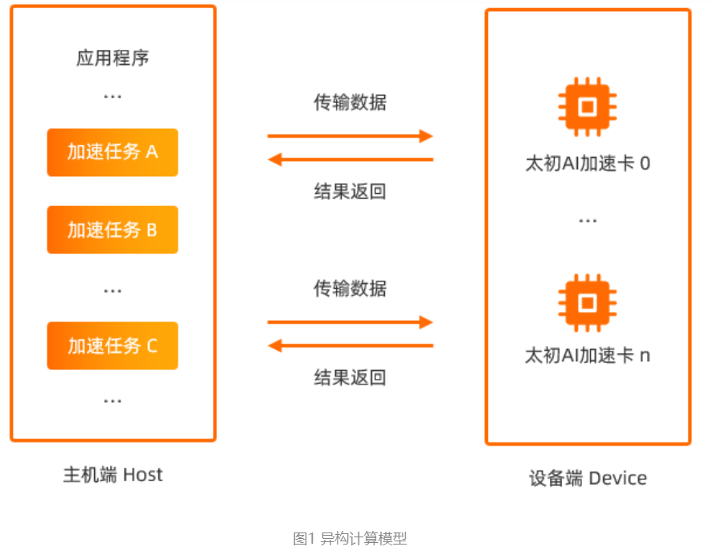
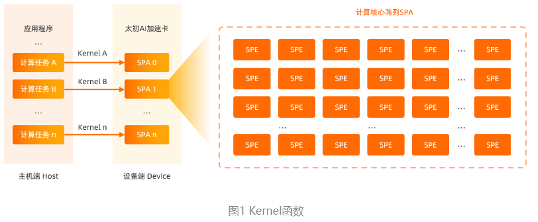
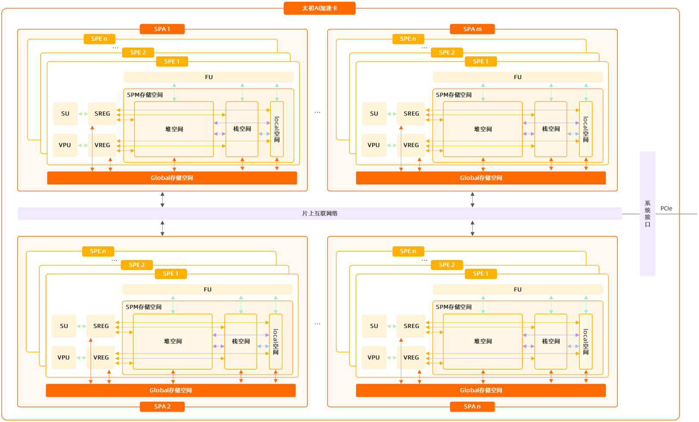
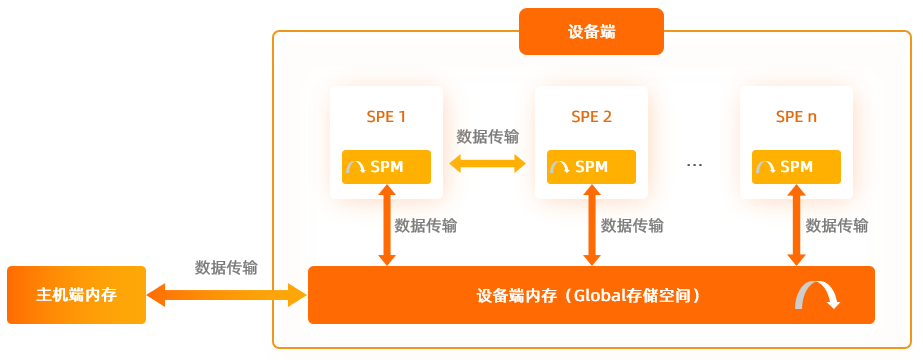

SDAA C异构计算模型是将应用程序中大量的计算任务，由主机端发送到设备端的计算核心阵列SPA执行，充分利用太初AI加速卡的硬件资源，提高程序的运行速度，缩短程序的运行时间。

太初AI加速卡负责处理大规模的数据运算（可参考SDAA异构并行模型），计算核心SPE在SDAA C中相当于一个线程，用户可以使用SPE进行异构并行计算。

Kernel函数是由__global__关键字修饰的函数，在设备端执行（类似于线程代码）。在使用SDAA C时，主机端通过调用Kernel函数将大量的计算任务分配给SPE执行，从而提高数据的处理效率。

太初AI加速卡由多个计算核心阵列SPA组成，每个计算核心阵列SPA由threadDim个计算核心SPE和Global存储空间构成。每个计算核心SPE都拥有独立的计算、访存和控制功能，是一个独立的处理器核心，可以独立完成一个计算任务。每个计算核心SPE由FU、SU、SREG、VPU、VREG以及SPM存储空间组成。

数据传输管理主要包括：主机端内存与设备端内存（Global存储空间）之间的数据传递、同一计算核心阵列SPA的Global存储空间内的数据传递、Global存储空间与SPM存储空间之间的数据传递、同一计算核心阵列SPA内不同计算核心SPE之间SPM存储空间的数据传递、以及同一计算核心SPE的SPM存储空间内的数据传递。

