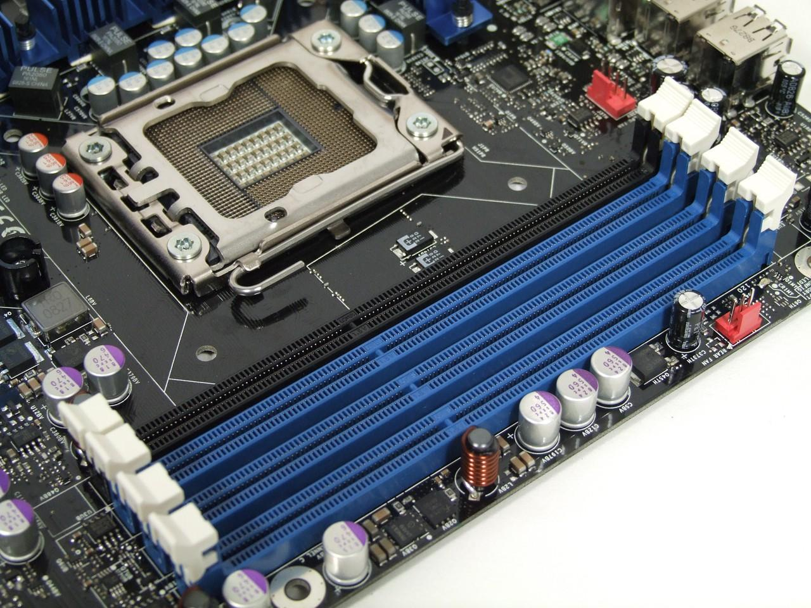
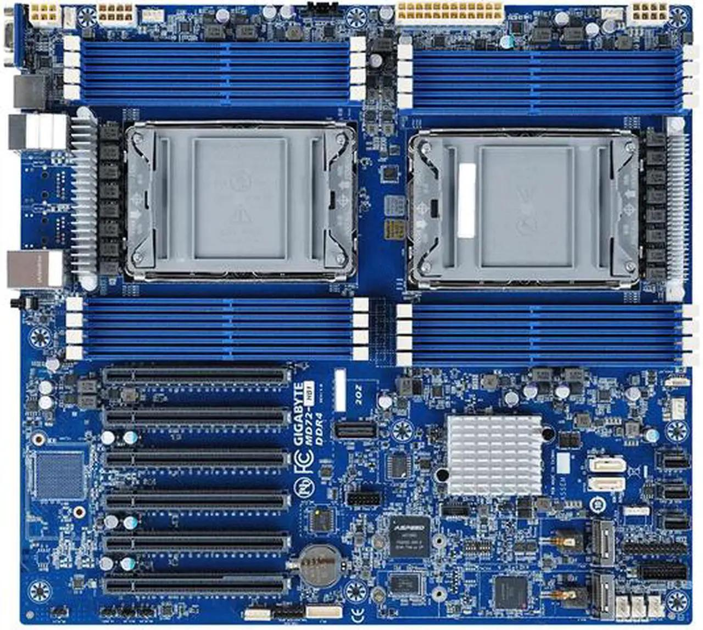

# 计算机

## 1. HBM（High Bandwidth Memory）和SRAM（Static Random-Access Memory）
```bash

两种不同类型的计算机内存。

HBM是一种高带宽内存接口，用于3D堆叠的SDRAM，具有较高的带宽和较低的功耗。
SRAM是一种静态随机访问存储器，用于高速缓存等内部存储器，具有更快的访问速度和更低的延迟，但成本更高且占用更多芯片空间。

```

## 2. MAC

```bash

MAC（Memory Access Cost，存储访问开销）是指在计算机系统中，访问内存或存储器所需的时间和资源开销。它是衡量计算机程序或算法性能的重要指标之一。 MAC的值取决于多个因素，包括内存层次结构、缓存命中率、内存带宽、存储器延迟等。较低的MAC值表示访问内存的开销较小，而较高的MAC值表示访问内存的开销较大。

```


1. 需要使用sdaa_kernel_pilot_hermes这个skill，完成/root/code/teco-agent-skills/teco-ops/op_learning/reshape_and_cache/fp16-cache-write/learning_task.md这个任务，利用humanize-kernel-agent-loop进行优化，目标进行10次优化思路，找到最好的
    reshape_and_cache算子的路径如下：/root/node_modules/opencode-linux-loong64/bin/projects/tmp2/teco-ops-juzhenjisuan/teco/ual/kernel/reshape_and_cache在这个目录下面


2. 使用 teco-kernel-optimizer 优化 teco-ops 中的 flash_attn_varlen_func。
先跑 baseline，记录正确性和性能，再进行多轮候选实现、benchmark、champion 选择和消融归因。
每轮只保留通过 correctness 的候选，并在最终总结中说明最佳版本、性能变化、验证命令和剩余风险。
    flash_attn_varlen_func算子的路径如下：/root/node_modules/opencode-linux-loong64/bin/projects/tmp2/teco-ops-juzhenjisuan/teco/ual/kernel/flash_attention在这个目录下面

评估说明：

对每个算子的评估都要完整的分别使用下面的流程

cd /root/node_modules/opencode-linux-loong64/bin/projects/temp/teco-ops-juzhenjisuan
bash build.sh --build teco

cd test
source env.sh
sh build.sh -arch teco

在执行下面的命令前，你要去检查一下，zoo/teco/{算子名}/test_case/ 这个目录下面有没有目录，有的话进行删除
./build/demo --gid=0 --perf_repeat=50 --warm_repeat=3 --gtest_repeat=1 --case_path=zoo/teco/{算子名}/test_case/{case}.prototxt 

补充：
{算子名}：分别是上面两个算子的名字
{case}.prototxt ：这个根据目录下面的.prototxt文件来对应填写。第一个算子评估zoo/teco/reshape_and_cache/test_case/目录下的0，1，2三个测例。对于第二个算子，只评估zoo/teco/flash_attn_varlen_func/test_case/目录下的1，3，5号prototxt测例。


## 3.
个人电脑的CPU结构：一个CPU和自己的一组内存条

多CPU的电脑的结构：一个CPU有自己的两组内存条，每组内存条到CPU中每个核的距离不同


为什么"两端插槽"常常确实对应 2 node
因为很多设计里，物理上分开的插槽是分别走不同的内存通道/控制器簇（走线长度不同、延迟不同）。这时固件（ACPI SRAT）把它们声明为 2 个邻近域 → 2 个 node。但这是"往往"，不是"必然"。

## 1. 先分清内存、缓存、距离

CPU 芯片内部的存储叫**缓存（cache）**，不是内存；真正的"内存"（DRAM 内存条）在**主板**上，芯片外。

| 存储 | 在哪 | 本机容量 | 相对速度 |
|---|---|---|---|
| 寄存器 | 核里 | 几 KB | 最快 |
| L1 缓存 | 核里 | 4 MiB | 很快 |
| L2 缓存 | 核里 | 16 MiB | 快 |
| L3 缓存 | 芯片上 | 128 MiB | 较快 |
| **内存 DRAM（内存条）** | **主板上，芯片外** | **≈1 TB** | **慢（相对）** |

关键：内存条**不在 CPU 里**，通过内存总线连接到 CPU 内的**内存控制器（IMC）**。

---

## 2. 什么是 NUMA

**NUMA（Non-Uniform Memory Access，非统一内存访问）**：内存物理上分布在不同位置，导致不同核访问不同内存的**速度不一样**。

- **本地访问**：核 → 本芯片的内存控制器 → 本地内存条，快
- **远端访问**：核 → 别的控制器/片间总线 → 别的内存条，慢

本机实测距离：**本地 `10`，远端 `21`（慢约 2.1 倍）**。

> NUMA 的本质：内存物理分布不均，访问代价不同，OS 必须知道"哪个核离哪块内存近"。

---

## 3. NUMA 节点是怎么划分的

### 3.1 一句话定义

**NUMA 节点 = 固件把"一组内存控制器 + 离它最近的那批 CPU 核"打包成的邻近域（proximity domain），Linux 呈现为 `/sys/devices/system/node/nodeN`。**

### 3.2 划分依据：内存亲疏，不是核数

- 按**访问距离/邻近性**划分；
- 不按 CPU 数或核数平均分；
- 一个节点 ≈ 一段内存 + 能最快访问它的那批核。

### 3.3 谁来划分：硬件 + 固件，Linux 照抄

```
硬件：内存控制器/通道物理分布在不同位置
   ↓
固件：ACPI SRAT 表声明"哪些核 + 哪些内存属于哪个邻近域"
   ↓
Linux：读 SRAT，生成 node0/node1/... → lscpu、numactl、/sys 均可查
```

**方向别搞反**：不是 OS 决定分几个 node，而是硬件内存拓扑本来就有 N 个亲疏域，固件如实声明。

### 3.4 划分的粒度：node 级，不是核级

- NUMA 只给 **node 之间**定义距离（N×N 矩阵）；
- **同一 node 内，所有核被视为到该 node 内存同距**；
- **不同 node 之间**才区分远近。

### 3.5 节点数由什么决定

取决于**一颗芯片有几组内存控制器域（NPS 模式）**，与核数无关：

| 芯片内存域数 | 每 socket 的 node 数 | 术语 |
|---|---|---|
| 1 组 | 1 | NPS1（常见 x86 双路：2 socket = 2 node） |
| **2 组（本机）** | **2** | **NPS2** |
| 4 组 | 4 | NPS4 |

> 在当前工作区未找到该机器固件原始 SRAT 记录（`dmesg` 无权限），下列数据结构由 sysfs/`numactl` 实测得到，非逐字节解析 ACPI 表。

### 3.6 为什么一颗 CPU 内部也要分 node

因为**一颗 CPU 的内存本身就不均匀**：芯片内可能有多个控制器簇，位置不同，核只对"自己那半个域"的内存最近。不分的话，OS 会把数据放到本 CPU 的"远半"上，核还得走远路。

**分 node 的依据是"内存域"，不是"CPU 边界"。**

---

## 4. 本机的真实拓扑

### 4.1 基本结构

```
架构:        loongarch64 (Loongson-3C6000/D)
Socket(s):          2      ← 2 颗物理 CPU 芯片
Core(s) per socket: 32     ← 每颗 32 个物理核
Thread(s) per core: 2      ← 每个物理核 2 个超线程
CPU(s):             128    ← 2 × 32 × 2
NUMA node(s):       4
```

### 4.2 node 与 socket 的对应

```
Socket 0 (package 0) = CPU 0-63
   ├── node0 = CPU 0-31    (内存域 A, ≈259 GB)
   └── node1 = CPU 32-63   (内存域 B, ≈265 GB)

Socket 1 (package 1) = CPU 64-127
   ├── node2 = CPU 64-95   (内存域 C, ≈265 GB)  ← SDAA 卡挂在这里
   └── node3 = CPU 96-127  (内存域 D, ≈265 GB)

总内存 ≈ 1.06 TB
```

### 4.3 距离矩阵（实测）

```
       0   1   2   3
  0:  10  21  21  21
  1:  21  10  21  21
  2:  21  21  10  21
  3:  21  21  21  10
```

要点：
- 全机只有两档：本地 `10`、远端 `21`；
- `node0↔node1`（**同一颗 CPU 内**跨 node）= 21；
- `node0↔node2`（**跨 CPU**）= 21；
- **本机跨 CPU 与同 CPU 跨 node 并列最远**（不必然在所有机器上都相等）。

### 4.4 层级关系

```
Socket / package（一颗物理 CPU 芯片）
   └── NUMA node（芯片内的内存域 + 就近核）
          └── core（物理核 → ×2 超线程 = 逻辑 CPU）
```

- **node 不跨 socket**，永远隶属于某颗芯片；
- 一个 socket 内可能有 1、2 或多个 node。

---

## 5. 物理核 / 超线程 / socket 的关系

```
2 socket × 32 物理核 × 2 超线程 = 128 逻辑 CPU
```

- **物理核**：真正的运算单元，有自己的 ALU/FPU。
- **超线程（SMT）**：一个物理核向 OS 暴露成 2 个逻辑 CPU，**共用同一套执行单元**。
- 本机 `thread_siblings`：`CPU0`↔`CPU1` 同核，`CPU2`↔`CPU3` 同核……

SMT 的行为（本机实测，用 `taskset` 钉核跑 CPU 密集程序）：

| 场景 | 现象 | 原因 |
|---|---|---|
| 同一逻辑 CPU 放 2 进程 | 时间 ×2 | 一条指令流，时间片轮流 |
| 兄弟核 + 延迟型负载 | 不变慢（吞吐 ~×2） | SMT 填流水线空闲 |
| 兄弟核 + 吞吐型负载 | 时间 ×2 | 共用执行单元被占满 |
| 不同物理核 | 永不变慢 | 各自独立硬件 |

启示：**要真并行，host 线程应绑到不同物理核（如 64,66,68…），而不是同核兄弟（64,65）。**

---

## 6. 什么是 NUMA 绑核

### 6.1 一句话定义

**NUMA 绑核 = 把一个进程/线程固定到指定的 CPU 核上，使它（连同它的内存）都留在某个 NUMA 节点内，从而让 CPU、内存、设备三者"就近工作"，避免跨节点的高延迟。**

### 6.2 它是两个动作合在一起

1. **绑 CPU（affinity）**：把线程钉在指定逻辑 CPU，不让调度器迁走 → `taskset` / `sched_setaffinity`
2. **绑内存（memory policy）**：让线程分配的内存落在同一 node → `numactl --membind`，或靠 **first-touch** 天然实现

### 6.3 为什么绑

- 不绑：线程可能被调度到 node0，数据在 node2 → 每次访存跨节点；
- 数据可能分配到 node3，卡在 node2 → 每次 H2D/D2H 拷贝跨节点；
- 绑核就是强制"线程 + 内存 + 设备"落在同一个 node。

### 6.4 first-touch（重要）

> Linux 内存**首次触碰（first-touch）时分配在调用线程当前所在 node**。

所以**先绑 CPU，再分配内存**，内存就自然落在该 node——在无权限设 `membind` 时，这是达成内存本地化的关键。

---

## 7. 绑核的三种实现位置

| 位置 | 做法 | 特点 |
|---|---|---|
| 启动脚本外层 | `numactl` / `taskset` 包住命令 | 最灵活、零改代码，**默认推荐** |
| 库/模块导入时 | `PYBIND11_MODULE` init 里 `sched_setaffinity` | 一次设置、全局生效；但硬编码卡↔node 映射，多卡/换机易错 |
| 框架建线程时 | vLLM/推理 worker 建线程处绑定 | 最贴合部署，改动大 |

---

## 8. 本机的具体绑定目标与命令

### 8.1 找设备挂在哪个 node

```bash
# teco-smi 显示 gid=0 → Bus-Id 00000002:06:00.0
cat /sys/bus/pci/devices/0000:02:06.0/numa_node
# → 2   即 SDAA 卡在 node2 → CPU 64-95
```

结论：**SDAA 卡 = NUMA node 2 = CPU 64-95**。

### 8.2 绑定命令

```bash
# CPU + 内存都绑 node2（本机 membind 会因权限失败，见第 10 节）
numactl --cpunodebind=2 --membind=2 ./build/demo --gid=0 --perf_repeat=50 ...

# 只绑 CPU（本机可用），靠 first-touch 落内存
numactl --physcpubind=64-95 ./build/demo --gid=0 --perf_repeat=50 ...

# taskset 等价写法
taskset -c 64-95 ./build/demo --gid=0 ...
```

### 8.3 Python 里绑

```python
import os
os.sched_setaffinity(0, set(range(64, 96)))   # 绑到 node2
```

对应评测脚本：`.opencode/skills/teco-ops-agent/ops/kernel-bench/scripts/teco_ops_test.py` 中调用 demo 的位置（`demo_cmd`）外层加 `numactl`。

### 8.4 真并行要选不同物理核

node2 的 32 个逻辑 CPU 其实是 16 个物理核（64/65、66/67… 成对）。若算子线程是吞吐型的，应按物理核跳选：

```
CPU 64, 66, 68, 70, ...（跨物理核）
而不是 64, 65, 66, 67（一半在抢兄弟）
```

---

## 9. 怎么验证绑核生效

```bash
# 当前亲和性
taskset -pc $$                              # 当前 shell
grep Cpus_allowed_list /proc/self/status    # 允许的 CPU 列表
grep Mems_allowed_list /proc/self/status    # 允许的内存 node

# 对照实验
numactl --physcpubind=0-31  bash -c 'grep Cpus_allowed_list /proc/self/status'  # node0（远）
numactl --physcpubind=64-95 bash -c 'grep Cpus_allowed_list /proc/self/status'  # node2（近）

# 内存落点统计（需权限）
numastat
```


## wall time

Wall 时间（墙钟时间 / wall-clock time）指的是真实流逝的时间，也就是从墙上挂钟能看到的时间——从程序开始到结束实际经过的时长，包括等待 I/O、休眠、被调度暂停等所有时间。
对比几个概念：
- Wall time：现实世界流逝的时间（比如你看了下手表，过了 5 秒）。
- CPU time：进程实际占用 CPU 的时间，可细分为 user time（用户态）和 sys time（内核态）。
- Wall time ≠ CPU time：如果程序大部分时间在等待网络/磁盘，wall time 会远大于 CPU time；如果是多线程并行，CPU time 可能大于 wall time。
常见用途：性能测试中 time 命令、/usr/bin/time 的输出，以及 Linux 的 CLOCK_MONOTONIC / gettimeofday 测量的都是 wall time。

- 测响应时间/延迟（latency）、吞吐（throughput/QPS） → 基本都用 wall time。比如压测工具（JMeter、wrk、ab）统计的响应耗时、每秒请求数，都是墙钟时间。
- 测 CPU 密集度、算法效率 → 常用 CPU time。因为想排除 I/O 等待和调度噪声，看代码本身花了多少 CPU。
- 基准测试框架会两者都用，例如：
- Go 的 testing.B 默认报告 wall time（ns/op），但也提供 -cpuprofile、-benchmem。
- JMH 同时报告 wall time、CPU time、GC 时间。
- perf stat 会同时给出 task-clock（CPU time）和 elapsed（wall time）。
为什么压测多用 wall time：用户真正感知的是"我发了请求多久拿到响应"，这才是业务关心的延迟，包含了排队、网络、等待等所有环节。
什么时候必须用 CPU time：多线程/多核场景下，wall time 无法反映总计算量（4 核跑满 10 秒，wall 是 10s 但 CPU time 是 40s）；或者被测代码有很大时间在 sleep/等待，用 wall time 会失真。
简单记：面向用户/系统的端到端性能 → wall time；面向代码本身的效率 → CPU time。