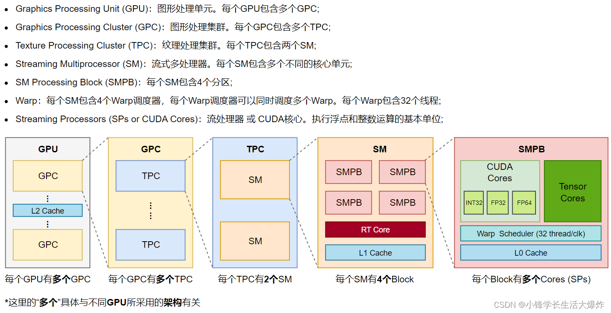
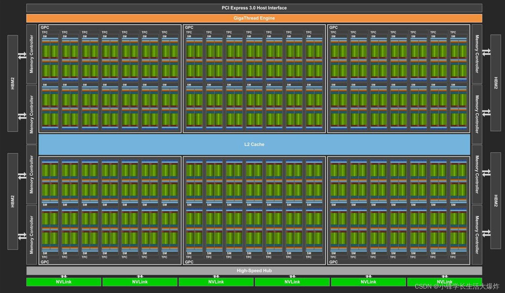
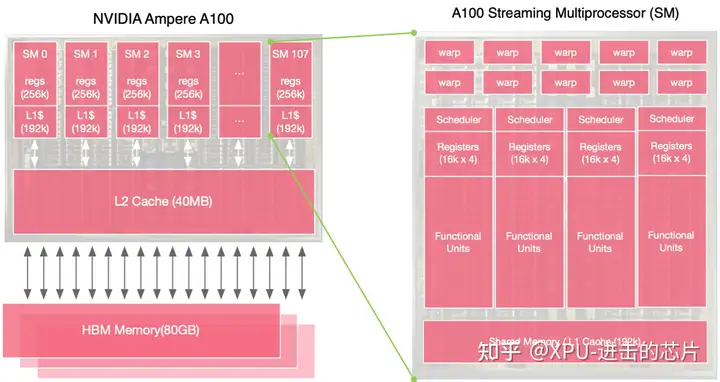

时钟：
电路的电流（信号）的传播是需要时间的，如果在电流传播还没完成，那么这个时候读取的是一个乱码错误数值。因此要需要一个节拍器（时钟）来统一的规定好在什么时候进行执行一次指令。CPU 里信号路径长短不一。决定周期的是最长、延迟最大的那条，叫关键路径（critical path）。

CPU 里成千上万个部件（加法器、缓存、寄存器）要配合工作。（时钟）一响，大家一起更新状态，就像交响乐团靠指挥对齐，不然各演奏各的。

CPU 内部有一个时钟（clock），像节拍器/鼓点一样"嘀嗒嘀嗒"跳动。每跳一下叫一个时钟周期（cycle）。CPU 的所有动作都严格对齐这个节拍：这一拍取指令，下一拍译码，再下一拍执行……没有节拍，电路就不知道什么时候该更新状态。
类比：一个工厂的电铃。铃响一次，所有工人同步做"下一个动作"。CPU 就是按铃的节奏在跑。

GHz 就是时钟信号（clock signal）每秒振荡/翻转的次数。时钟本质上是一个在 0 和 1（低电平 / 高电平）之间来回翻转的方波电信号：
- 一个完整的"低→高→低"叫作一个时钟周期。
- 3.0 GHz = 这个方波每秒完成 30 亿个周期。
- 周期时长 = 1 / 3×10⁹ 秒 ≈ 0.33 纳秒。

时钟信号自己不停地 0→1→0 循环，每个循环是一个周期；每个周期的边沿让 CPU 往前走一步；一条指令要走很多步（很多个周期）才完成。

元件有「建立时间 setup time」和「保持时间 hold time」的要求，信号要提前一点点稳定、之后还要保持一小会儿。再加上时钟偏斜（不同地方时钟到达有偏差）、温度/电压波动，所以周期要留够余量。

CPU的存储：
规律：越靠近 CPU 越快、越贵、越小；越往外越慢、越便宜、越大。
类比：你（CPU）在书桌上工作。
- 寄存器 = 你手里正拿着的那点东西
- L1/L2 = 书桌抽屉 / 书桌旁的书架
- L3 = 房间里的书架
- 内存 = 楼下图书馆
- 硬盘 = 城市另一头的仓库

你要用一本书，先得跑到对应楼层把它拿来。楼层越远，跑一趟越慢。

数据搬运的完整流程
当你执行 C[i] = A[i] + B[i] 时，实际发生的是：
1. 取数：CPU 发现需要 A[i]、B[i]。
先查 L1 → 没有？查 L2 → 没有？查 L3 → 还没有？→ 去内存取。
2. 搬运：内存里的数据不是直接进运算单元的，而是逐级往上搬：
内存 → L3 → L2 → L1 → 寄存器。
3. 计算：两个数都到了寄存器，ALU 才能做加法。
4. 写回：结果从寄存器写回，再逐级往下送。
关键点：运算单元只能直接操作寄存器里的数据。"加法很快"没错，但前提是数据已经躺在寄存器里了。而把数据搬进寄存器这一路，往往比加法本身慢几十倍。

什么是一个"核"（Core）
一句话：一个核 = 一套能独立"取指令 → 译码 → 执行 → 写回"的完整执行单元。它是 CPU 里能独立跑一段程序的最小单位。
层次关系：芯片 → 核 → 执行单元
一颗 CPU 芯片（chip / die）
   ├── 核 1   ← 就是一个"核"
   │     ├── 控制单元（取指、译码、调度）
   │     ├── 寄存器堆（几十个寄存器）
   │     ├── ALU / FPU（多个运算单元）
   │     └── L1 Cache（私有的小缓存）
   ├── 核 2
   ├── 核 3
   ├── ...
   └── L3 Cache（多核共享）
- 芯片：整块硅片。
- 核：芯片上被切分出来的、能各自独立干活的处理器。
- 执行单元（ALU 等）：核里面干具体运算的零件。
关键：核 = 一整套东西的集合（控制 + 寄存器 + ALU + 私有缓存），不是单个零件。所以"一个核里有多个 ALU"，而"8 个核"是 8 套这样的完整集合。

通常是这样：L1、L2 每个核各有一套（私有），L3 是多个核共享一套。 也就是说，*共享的只有 L3 这一层，不存在"共享的 L1、L2、L3 一整套"*。
典型结构
          核 1                核 2                核 3        ...
       ┌────────┐          ┌────────┐          ┌────────┐
       │ L1     │ 私有      │ L1     │ 私有      │ L1     │ 私有
       │ L2     │ 私有      │ L2     │ 私有      │ L2     │ 私有
       └───┬────┘          └───┬────┘          └───┬────┘
           │                   │                   │
       ┌───┴───────────────────┴───────────────────┴────┐
       │                  L3 Cache（共享）                │
       └───────────────────────┬─────────────────────────┘
                               │
                         主存 RAM（共享）
- L1：每个核私有（而且是最快、最小的，通常还分成指令 L1 和数据 L1）
- L2：每个核私有（比 L1 大、稍慢）
- L3：所有核共享（最大、更慢，是核与内存之间的最后一道缓冲）
- 内存 RAM：所有核共享

GPU

内存带宽 = 单位时间内能从内存搬进/搬出多少数据，衡量的是「搬运速度」，单位一般是 GB/s（每秒多少 GB）。

FLOPS = Floating-point Operations Per Second，每秒浮点运算次数，衡量的是「计算速度」，单位是「次/秒」。

算术强度 = 「算的多不多 ÷ 搬的多不多」。强度低就说明「搬得太多、算得太少」，瓶颈在带宽。知乎那段的实质是：改成 FP16 后搬运字节减半，分子没变，所以强度翻倍、带宽压力减半——注意是「减分母」，不是「加分子」。

但要补一点层次区别，避免绝对化：
1. 主存到缓存：按 cache line 搬。 这是核心答案。DRAM 一次读一整条 line（或一个 sector 子块），这就是「一次读取一个 cache line」。
2. CPU 核心和 ALU 实际用的是「字」，不是整条 line。它要的是那 4/8 字节（一个 word），只是这个 word 坐在某条 line 里，line 被整条搬进缓存后，再从里面取出这个 word。所以「搬运单位」是 line，「计算使用单位」是 word。
3. 有些架构里 line 还分 sector：比如 128 字节的 line 分成 4 个 32 字节的 sector，可以只取需要的 sector，不必整条都搬。粒度更细一点。
一句话
在主存和缓存之间，读取/搬运的基本单位就是 cache line（一次一条）；但到了核心内部真正参与运算的，还是其中一个 word。

HBM(A,B) ──► 片上缓存(LDM) ──► 寄存器(ACE) ──累加K片──► 寄存器 ──► HBM(C)
   搬一次            搬多次             算           算完才写回
核心思想：A 和 B 需要被反复读取（复用），所以尽量搬到高速缓存里重复用；C 是累加结果，只在最后写回一次。分块的目的就是让每次搬运的数据在片上被尽可能多次使用，减少慢速 HBM 的访问量。

核心、以及核心数

-------------------------------------------------------------

矩阵等在内存中的样子：
矩阵在计算机里不是二维的，而是拉平成一维数组存起来（行优先 row-major）。
矩阵 A (2×3):
[ a b c ]
[ d e f ]
在内存里就存成一段连续地址:
地址:  0   1   2   3   4   5
数据:  a   b   c   d   e   f
访问 A[i][j] 时的公式就是：地址 = i * 列数 + j。例如 A[1][2] = 地址 1*3+2 = 5 = f。
记住这一点，后面 GPU 全是在这段连续内存上做文章。

-------------------------------------------------------------

CPU 的内存叫 Host（主机内存），GPU 的内存叫 Device（显存）。它们中间隔着 PCIe 总线，不能直接互相访问，必须拷贝。
[CPU 内存]  --PCIe 搬运-->  [GPU 显存]  --计算-->  [GPU 显存]  --PCIe 搬回-->  [CPU 内存]
   原始A,B                      A,B                       结果C                     结果C

-------------------------------------------------------------

PCIe是什么

-------------------------------------------------------------

GPU 的工人（线程 thread）按三级组织：
Grid（整个工程队）
 └── Block（施工队，一个 block = 比如 16×16 = 256 个线程）
      └── Thread（工人，一个线程负责算一个输出元素）
每个线程都能通过一个唯一编号找到自己，比如：
int row = blockIdx.y * blockDim.y + threadIdx.y;  // 我是第几行
int col = blockIdx.x * blockDim.x + threadIdx.x;  // 我是第几列
这就是「我在矩阵的哪个位置干活」的定位方式。

-------------------------------------------------------------

示意图（4×4，每个格子由一个线程负责）：
        B的列 →
       ┌───┬───┬───┬───┐
A的行  │   │   │   │   │   每个格子里
  ↓    ├───┼───┼───┼───┤   一个线程
       │   │ ● │   │   │   在算 A的row行 · B的col列
       ├───┼───┼───┼───┤
       │   │   │   │   │
       └───┴───┴───┴───┘
几千个线程同时算各自的格子 —— 这就是 GPU 的威力：本来要跑 N² 次的双重循环，现在 N² 个线程并行跑。

-------------------------------------------------------------

kernel 里写的是「一个线程要干的事」，但你启动了几万个线程，这段代码就被几万个线程各跑一遍。

-------------------------------------------------------------

同一个 kernel 代码，被分配给上万个线程，每个线程都拿到一份

-------------------------------------------------------------

kernel 是「一个线程该执行的代码」，所有线程共用同一份；它被每个线程各执行一遍，而不是被复制到每个核心；核心是公共资源，由调度器轮流把各线程的指令喂给它执行。

-------------------------------------------------------------

每个调度器只管自己处理块的 32 个核心，4 个调度器独立并行、互不干涉；warp 分到哪个处理块就归哪个调度器管。但注意——L1/共享内存是整个 SM 的 4 个处理块共用的，那块是跨调度器的。